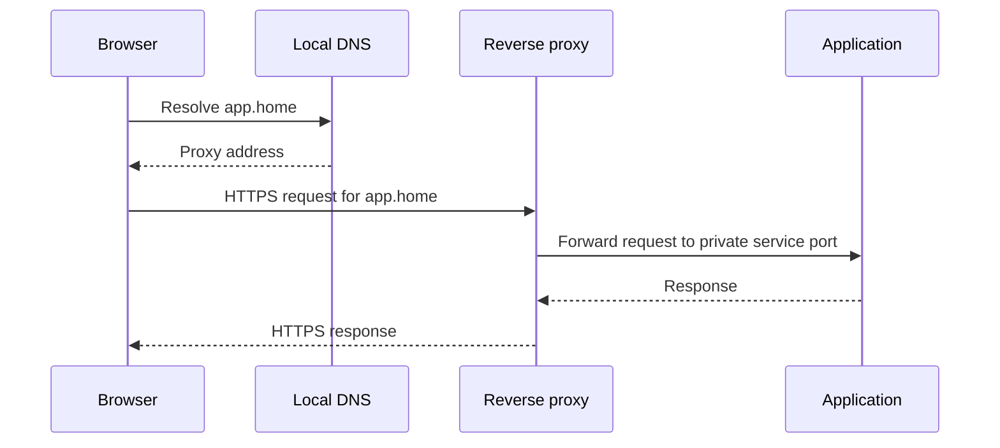

🗓️ 11102026 1535

# service_access

The request path combines name resolution, HTTPS routing, and a controlled remote-access method.

## Terms

| Term | Definition | Source |
|---|---|---|
| **Domain Name System (DNS)** | A distributed naming system that maps names to resource records. | [RFC 1034](https://www.rfc-editor.org/rfc/rfc1034) |
| **Reverse proxy** | A proxy server that receives client requests and forwards them to backend servers. | [NGINX](https://docs.nginx.com/nginx/admin-guide/web-server/reverse-proxy/) |

## One local request

DNS does not authenticate users. TLS protects transport and binds certificates to names. It does not authorize application actions. A proxy is another trust boundary; keep backend ports private.

## Remote access options

- **VPN:** WireGuard connects authenticated devices to private networks.
- **Managed overlay:** Tailscale simplifies enrollment; its control plane adds dependency.
- **Self-hosted overlay:** Headscale offers control but adds operations.
- **Public proxy:** HTTPS exposes selected services and increases attack surface.
- **Vendor relay:** Avoids router changes but depends on provider limits.

Keep admin interfaces and databases private. Never forward DSM, SSH, database, or container-control ports publicly. Caddy and Traefik are open-source proxy options. See [[reverse_proxy]] and [[nginx_config_structure]].

## Common failures

Timeouts suggest routing or firewall problems. Refused connections suggest a listener or port mismatch. TLS errors point to names, certificates, or proxy configuration. Access denials belong to application authentication or authorization.

## Hands-on project

Give a test app a local DNS name and HTTPS proxy. Connect remotely through a VPN. Confirm DSM remains private. Preserve local recovery access before changing network rules.

## References

- reverse proxy
- [[tls]]
- [[acme_certificate_flow]]
- [[dns_tools]]
- [WireGuard documentation](https://www.wireguard.com/)
- [Caddy documentation](https://caddyserver.com/docs/)
