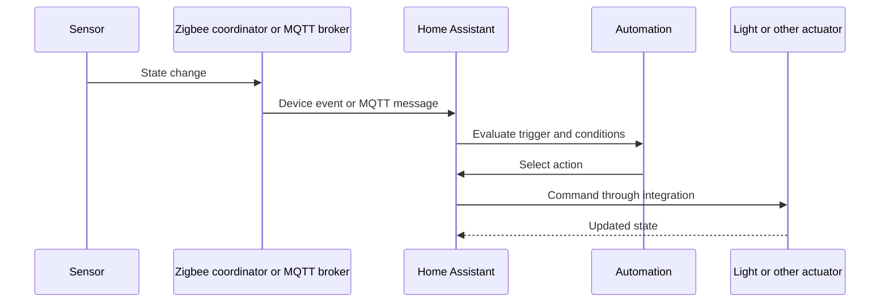

🗓️ 11102026 1535

# smart_home

A smart home connects sensors and devices to software that tracks state and triggers actions. Home Assistant coordinates integrations. Separate device, protocol, automation, and network roles when diagnosing failures.

## From sensor to automation

Integrations translate devices into Home Assistant entities. Automations evaluate triggers and conditions before acting. Sensors and actuators may use different protocols. Cloud integrations still need internet access.

## Protocols and tools

- Wi-Fi and Ethernet connect devices through IP networks.
- Zigbee uses a coordinator and low-power mesh.
- Zigbee2MQTT bridges Zigbee devices to MQTT.
- Matter uses Wi-Fi or Thread transport.
- Thread is an IPv6 mesh requiring a border router.
- MQTT provides lightweight publish/subscribe messaging.
- Mosquitto is an open-source MQTT broker.
- Home Assistant supports dedicated, virtual, and container hosts.
- USB radios may favor separate always-on hardware.

Local protocols reduce cloud dependence. Compatibility, firmware, radio placement, and backups still matter. Cloud integrations may simplify setup but need internet access.

## Hands-on project

Publish a simulated temperature to MQTT. Create a Home Assistant sensor and threshold notification. Stop the broker. Observe unavailable state and automation fallback behavior.

## References

- [Home Assistant getting started](https://www.home-assistant.io/getting-started/)
- [Home Assistant MQTT integration](https://www.home-assistant.io/integrations/mqtt)
- [Zigbee2MQTT documentation](https://www.zigbee2mqtt.io/)
- [Matter specification overview](https://csa-iot.org/all-solutions/matter/)
