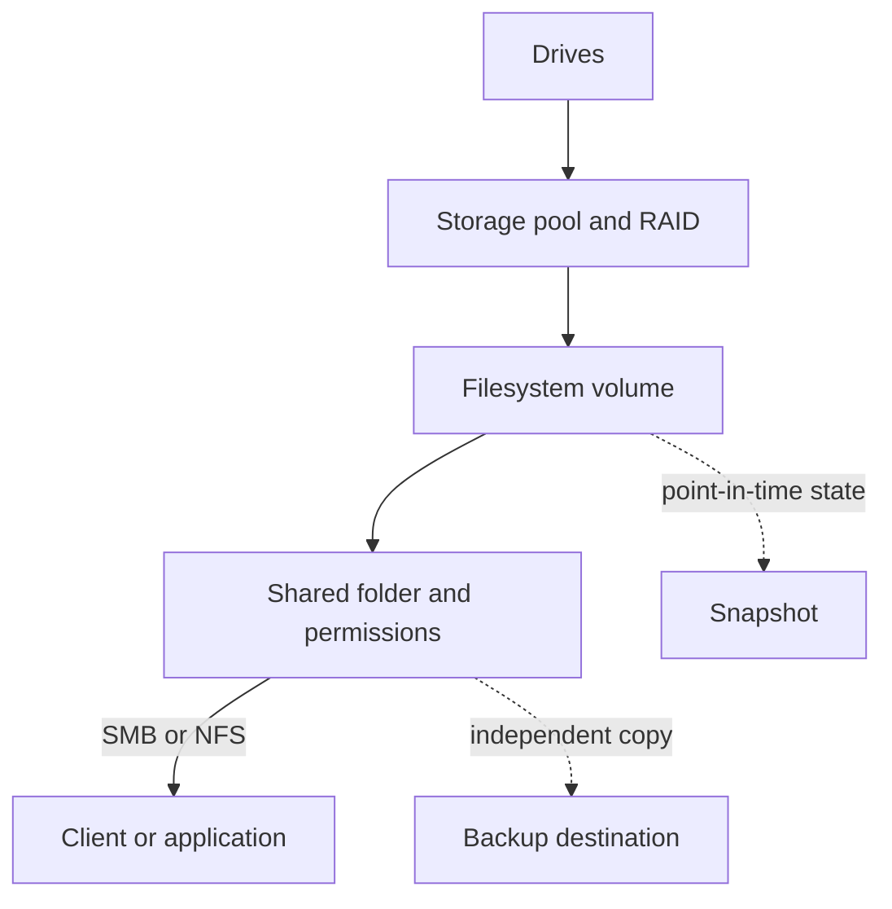

🗓️ 11102026 1535

# storage_raid_backups

NAS storage has layers: drives hold blocks, RAID arranges them, filesystems organize files, and shares expose paths. Each layer solves a different problem.

## Storage layers

RAID combines drives for capacity, performance, or drive-failure tolerance. It cannot recover deleted files or protect against malware, theft, fire, or NAS failure. RAID 0 has no redundancy. Mirrors and parity trade capacity for redundancy. Synology Hybrid RAID (SHR) automates layouts and can use mixed-sized drives. Support varies by model.

## Snapshots and backups

A snapshot records a point-in-time state for quick rollback. It usually stays on the same NAS, so it is not an independent copy. A backup copies data elsewhere: another NAS, external drive, or cloud. Protect credentials and test restores.

Plan the restore path before choosing a RAID layout:

| Need | Mechanism | Limitation |
|---|---|---|
| Survive supported drive failures | RAID or SHR | Does not restore deleted files |
| Undo recent changes | Filesystem snapshots | May share the NAS failure domain |
| Recover after device loss | Separate backup | Requires time and accessible credentials |

## Filesystem and protocol choices

Use Btrfs where supported snapshots matter. Other models may support ext4 instead. SMB suits mixed desktop clients; NFS suits many Unix-like hosts. iSCSI exposes blocks, leaving filesystem management to clients. Concurrent writable mounts require explicit filesystem support.

Synology Hyper Backup can copy data to several target types, while Snapshot Replication synchronizes supported snapshots. Availability and feature details depend on the model and DSM version. [Synology Hyper Backup](https://kb.synology.com/en-global/DSM/tutorial/How_to_back_up_your_data_to_a_remote_Synology_NAS_or_file_server_with_Hyper_Backup), [Snapshot Replication](https://kb.synology.com/en-global/DSM/tutorial/Quick_Start_Snapshot_Replication)

## Hands-on project

Compare capacity and drive tolerance with Synology's RAID Calculator. Create a test share and snapshot. Change and restore a file. Back it up elsewhere and restore it. Record each method's limits.

## References

- [Synology: What is SHR?](https://kb.synology.com/en-global/knowledgebase/tutorials/492)
- [Synology: choosing a RAID type](https://kb.synology.com/en-global/DSM/tutorial/What_RAID_type_is_best_for_my_storage)
- [Synology RAID Calculator](https://www.synology.com/en-us/support/RAID_calculator)
- [[nas_fundamentals]]
- [[docker_volumes]]
