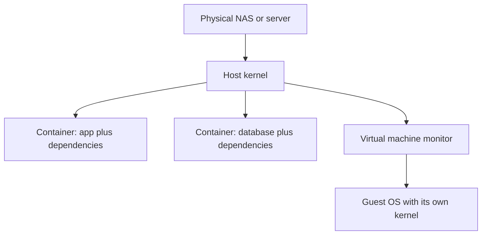

🗓️ 11102026 1535

# virtualization_containers

The isolation model determines whether a workload gets a guest operating system or shares the host kernel.

## Terms

| Term | Definition | Source |
|---|---|---|
| **Virtual machine** | A virtual computer that runs its own operating system on virtualized hardware. | [NIST](https://csrc.nist.gov/pubs/sp/800/125/r1/final) |
| **Container** | An isolated process that shares the host operating system kernel. | [Docker](https://docs.docker.com/engine/containers/) |

## Two execution models

A container isolates processes, files, and network interfaces while sharing the host kernel. A VM runs a guest OS on virtual hardware. Containers usually start faster and use less memory. VMs support different kernels and stronger OS boundaries, with greater resource cost.

Use containers for repeatable services when kernel sharing is acceptable. Choose a VM for another OS or stronger separation. Neither makes untrusted workloads safe automatically. Permissions, network access, updates, and limits still matter.

## On Synology

Synology Container Manager and Virtual Machine Manager depend on model and DSM support. A storage-focused NAS may lack CPU or memory for several services or VMs. Move compute to another host when useful.

For Linux-specific process, filesystem, user, and permission concepts, read [[for_self_hosting]]. For the container lifecycle, networking, and persistent data, follow [[container_learning_path]].

## Hands-on project

Create a small Linux VM and deploy a web app. Run it again as a container. Compare startup time, memory, and isolation. Recreate the container and check persistent data.

## References

- [[container_platform]]
- [[volumes]]
- [Docker Compose](https://docs.docker.com/compose/)
- [Synology Virtual Machine Manager](https://kb.synology.com/en-us/DSM/help/Virtualization/virtual_machine?version=7)
