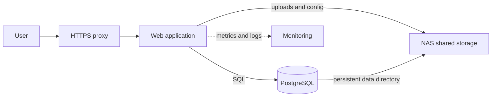

🗓️ 11102026 1535

# workloads

A workload combines an application, configuration, dependencies, state, and network access. Defining them together makes deployment and recovery repeatable.

## A small application stack

Compose describes services, networks, mounts, and configuration in YAML. Services find each other by name on a private network. Databases need persistent storage and separate backups. Restarting a container does not back up data.

Host file ownership and process identities affect whether a container can use a mounted directory. Review [[for_self_hosting]] alongside [[volumes]] when diagnosing permission errors.

## Workload types

- Applications include media catalogs, source control, and dashboards.
- Choose maintained images with documented data paths.
- Databases need durable volumes and protected credentials.
- Use application-aware or consistent database backups.
- Remote editors and CI can provide development environments.
- Separate source and caches from irreplaceable data.
- Synology packages simplify management but vary in support.
- A Linux host adds portability and compute capacity.

## Tools and trade-offs

Compose suits readable, single-host deployments. PostgreSQL supports general relational workloads; SQLite suits simpler single-process apps. Forgejo and Gitea host Git repositories but need maintenance. Add services for specific needs.

Keep secrets out of Git and images. Use protected files or a secrets manager. Give services stable names. Publish only required ports.

## Hands-on project

Deploy a web app and PostgreSQL with Compose. Use a named volume and non-admin database user. Test service-name discovery. Recreate the app, then restore a database backup in a disposable environment.

## References

- [[container_learning_path]]
- [[compose]]
- [[volumes]]
- [[container_networking]]
- [Docker Compose](https://docs.docker.com/compose/)
