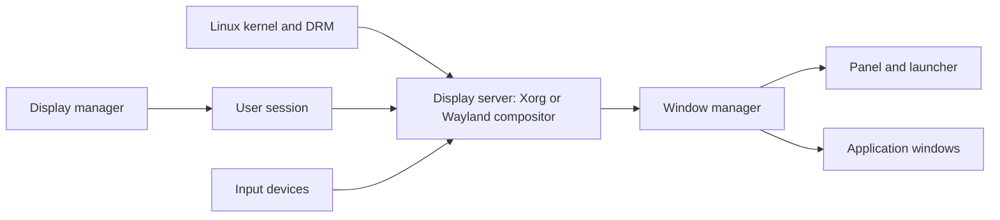

🗓️ 01062026 1727

# display_stack


A graphical Linux session depends on coordinated components from kernel display interfaces to the compositor and applications.

## Terms

| Term | Definition | Source |
|---|---|---|
| **Display server** | A system component that manages graphical output and input for client applications. | [Arch Wiki](https://wiki.archlinux.org/title/Xorg) |
| **Window manager** | A program that controls the placement, sizing, focus, and decoration of application windows. | [Arch Wiki](https://wiki.archlinux.org/title/Window_manager) |

The Linux display stack is the chain of components that takes you from powered-on hardware to a usable desktop. Each layer hands off to the next.

## The Chain

```
Hardware (GPU)
    ↓
Kernel — DRM/KMS initialises the display hardware
    ↓
Display server — X11 (Xorg) or Wayland handles rendering and input
    ↓
Display manager — login screen; authenticates and launches session
    ↓
Window manager / Desktop environment — arranges windows on screen
    ↓
Applications
```

## EndeavourOS i3 Stack

| Layer | Component |
|-------|-----------|
| Display server | X11 (Xorg) |
| Compositor | [[picom]] |
| Display manager | [[lightdm]] + slick-greeter |
| Window manager | [[i3]] |
| App launcher | rofi |
| Screen locker | i3lock-color |

## X11 vs Wayland

- **X11** — older, widely supported, required for NVIDIA on most setups. i3 runs on X11.
- **Wayland** — modern, better security and performance, compositor does what X11 + a WM did separately. Hyprland and Sway are Wayland-native.

```ad-note
EndeavourOS i3 edition ships with X11. Wayland support for i3 does not exist — switch to Sway for a Wayland equivalent.
```

## Where Each Concept Lives

- [[display_manager]] — what a DM is, how it starts sessions
- lightdm — LightDM config and slick-greeter theming
- [[window_manager]] — WM types and how they differ
- i3 — i3 config, keybindings, gaps, autostart
- picom — compositor config, blur/shadow/transparency options
- [[rofi_theming]] — rofi `.rasi` widget tree and theme structure
- [[screen_locker]] — i3lock-color flags and i3 integration



## References


- [Arch Wiki: Xorg](https://wiki.archlinux.org/title/Xorg)
- [Arch Wiki: Wayland](https://wiki.archlinux.org/title/Wayland)
