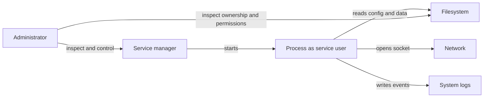

🗓️ 11102026 1535

# for_self_hosting

Linux systems use the Linux kernel with distribution-specific tools and packages. Many servers and NAS appliances use its process, filesystem, permission, and networking mechanisms. These explain what applications need from hosts.

## What a running service uses

- A **process** is a running program with resources and identity.
- **Users and groups** control process access to files and operations.
- The **filesystem tree** names files and directories.
- Ownership and permissions control access along each path.
- A **service manager** starts processes and tracks their lifecycle.
- `systemd` is common on Linux servers.
- **Logs** record events and failures.
- `journalctl` reads systemd logs; apps may log elsewhere.
- **Package managers** install software from distribution-specific repositories.

For file errors, check the process identity and path permissions. For reachability, check process state, listening address, port, and firewall. These checks isolate the failing layer.

## DSM and general Linux

Synology DSM is a managed NAS environment built on Linux. Concepts transfer, but packages, service management, filesystems, and upgrades differ. Prefer supported DSM interfaces. Use shell access only for understood, supported operations.

On Linux, `systemctl` controls services; `journalctl` reads logs. `ps` and `top` show processes. `ss` shows sockets. `stat` and `namei` inspect file permissions. Check distribution docs for specifics.

## Tools and trade-offs

- OpenSSH provides remote shell access; restrict accounts and reachability.
- SSH access grants administrative power.
- systemd manages services and logs on many distributions.
- Other systems use different service managers.
- Containers still rely on host kernel, storage, and networking.
- See [[virtualization_containers]] and [[container_learning_path]].
- Documented configuration is easier to reproduce and recover.

## Hands-on project

In a disposable Linux VM, create a service user and web service. Inspect its identity, file permissions, listening socket, and logs. Change one test setting and diagnose the failure.

## References

- [[virtualization_containers]]
- [[ssh]]
- [systemd documentation](https://systemd.io/)
- [OpenSSH manual pages](https://www.openssh.com/manual.html)
