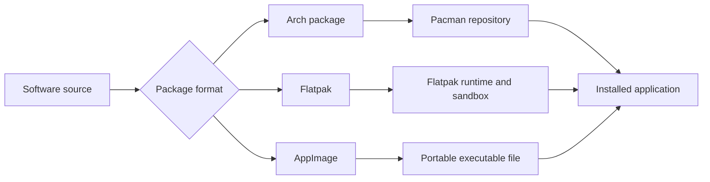

🗓️ 01062026 1727

# package_formats


Linux package formats differ in how they install, update, isolate, and integrate applications.

## Terms

| Term | Definition | Source |
|---|---|---|
| **Package manager** | A tool that installs, updates, and removes software packages while tracking their files and dependencies. | [Arch Wiki](https://wiki.archlinux.org/title/Pacman) |
| **AppImage** | A portable application format that bundles an application for execution without a traditional installation step. | [AppImage documentation](https://docs.appimage.org/introduction/index.html) |
| **Flatpak** | A framework for building, distributing, and running desktop applications in sandboxes. | [Flatpak documentation](https://docs.flatpak.org/en/latest/introduction.html) |

Linux software is distributed in multiple formats. On **EndeavourOS** (Arch-based), the native format is `.pkg.tar.zst` managed by [[pacman]]. Everything else is either a portable runtime or requires extra steps.

## Format Overview

| Format | Native on EndeavourOS? | How to install |
|--------|----------------------|----------------|
| `.pkg.tar.zst` | Yes — official repos | `sudo pacman -S pkgname` |
| AUR (PKGBUILD) | Yes — via AUR helper | `yay -S pkgname` (see [[aur]]) |
| `.AppImage` | Portable — runs anywhere | `chmod +x file.AppImage && ./file.AppImage` |
| Flatpak | Universal sandbox | `flatpak install flathub app.id` |
| `.deb` | No — Debian/Ubuntu format | Convert with `debtap`, then `sudo pacman -U` |
| `.rpm` | No — Red Hat format | Avoid; use AUR or Flatpak equivalent instead |
| Snap | Not supported by default | Snapd is on AUR but not recommended on Arch |

## Which to Pick

### Order of preference on EndeavourOS

1. **Official repo** (`pacman -S`) — tracked, updated, cleanest
2. **AUR** (`yay -S`) — community-built but integrates fully with pacman
3. **Flatpak** — good for GUI apps not in AUR; sandboxed
4. **AppImage** — zero install, self-contained; use when nothing else is available
5. **`.deb` / `.rpm`** — last resort; package may be missing deps or conflict

## Architecture

When downloading, pick the build that matches your CPU. Run `uname -m` to check — `x86_64` means pick x64. See [[cpu_architectures]] for details.

## AppImage Notes

AppImages don't integrate with your package manager, so they don't auto-update. For desktop integration (app launcher entry), use `appimagelauncher` from the AUR.

## Flatpak Setup

```bash
sudo pacman -S flatpak
flatpak remote-add --if-not-exists flathub https://dl.flathub.org/repo/flathub.flatpakrepo
```



## References


- [Arch Wiki: AUR](https://wiki.archlinux.org/title/Arch_User_Repository)
- [Flathub](https://flathub.org)
- [AppImageHub](https://appimage.github.io)
