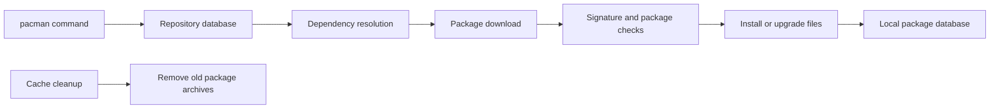

🗓️ 01062026 1727

# pacman

> **pacman**: Arch Linux's package manager for installing, upgrading, and removing packages from repositories. ([Arch Wiki](https://wiki.archlinux.org/title/Pacman))

Pacman keeps installed packages and repository metadata in sync.

## Package Operations

| Action | Command |
|--------|---------|
| Install package | `sudo pacman -S pkgname` |
| Install local file | `sudo pacman -U file.pkg.tar.zst` |
| Remove package | `sudo pacman -R pkgname` |
| Remove + unused deps | `sudo pacman -Rs pkgname` |
| Full system update | `sudo pacman -Syu` |
| Search repos | `pacman -Ss keyword` |
| List installed packages | `pacman -Q` |
| Find what owns a file | `pacman -Qo /path/to/file` |
| List explicitly installed | `pacman -Qe` |

## AUR Helpers

`yay` and `paru` wrap pacman and add AUR support — same flags, plus AUR packages. Prefer them over raw `pacman` for day-to-day use. See [[yay]] for the command reference.

## Cache Cleanup

```bash
sudo pacman -Sc     # remove old cached package versions
sudo pacman -Scc    # remove all cached packages (more aggressive)
```



## References


- [Arch Wiki: pacman](https://wiki.archlinux.org/title/pacman)
