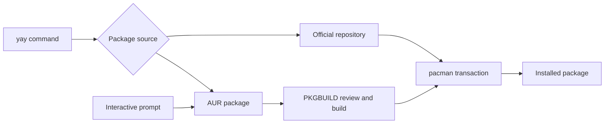

🗓️ 01062026 1727

# yay

> **yay**: An AUR helper that supports Arch repository and AUR package workflows. ([yay repository](https://github.com/Jguer/yay))

**yay** (Yet Another Yogurt) is the most widely used AUR helper on Arch-based systems. It wraps [[pacman]] and adds AUR support — same flags work for both official repo and AUR packages.

## One-Time Setup

```bash
sudo pacman -S --needed git base-devel
git clone https://aur.archlinux.org/yay.git
cd yay && makepkg -si
```

## Common Commands

| Action | Command |
|--------|---------|
| Install (AUR or official) | `yay -S pkgname` |
| Update everything | `yay -Syu` |
| Update AUR packages only | `yay -Sua` |
| Remove package | `yay -R pkgname` |
| Search | `yay pkgname` |
| Clone PKGBUILD without installing | `yay -G pkgname` |
| Print PKGBUILD | `yay -Gp pkgname` |
| Update VCS/git packages | `yay -Syu --devel` |
| Show stats | `yay -Ps` |

## Interactive Prompts

By default yay prompts to review diffs and edit PKGBUILDs. To skip for trusted packages:

```bash
yay -S pkgname --nodiffmenu --noeditpkgbuild
```



## References


- [yay GitHub](https://github.com/Jguer/yay)
- [Arch Wiki: AUR helpers](https://wiki.archlinux.org/title/AUR_helpers)
