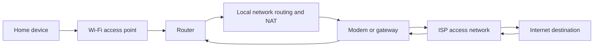

🗓️ 19112024 1801

# modem_vs_router

A modem or gateway connects a home network to an ISP; a router forwards traffic between networks.

## Terms

| Term | Definition | Source |
|---|---|---|
| **Modem** | A device that connects a local network to an internet service provider's access network. | [Cisco](https://www.cisco.com/c/en/us/solutions/small-business/resource-center/networking/what-is-a-router.html) |
| **Router** | A device that forwards packets between networks and commonly provides local address assignment and network address translation. | [Cisco](https://www.cisco.com/c/en/us/solutions/small-business/resource-center/networking/what-is-a-router.html) |

## Modem

- **Function**: A modem connects your home network to the internet through your Internet Service Provider (ISP). It translates digital signals from your ISP into a format that your devices can use (and vice versa) by modulating and demodulating signals.
- **IP Address**: Each modem has a public IP address that identifies it on the internet.
- **Network Type**: Operates on a Wide Area Network (WAN) level, facilitating the connection between your local network and the broader internet.
- **Physical Connections**: Typically has one Ethernet port for connecting to a router or a single device directly[
    
    1
    
    ](https://www.xfinity.com/hub/internet/modem-vs-router)[
    
    2
    
    ](https://www.spiceworks.com/tech/networking/articles/modem-vs-router/)[
    
    4
    
    ](https://us.hitrontech.com/learn/the-difference-between-a-modem-and-a-router/).

## Router

- **Function**: A router creates a local area network (LAN) within your home. It connects multiple devices (like computers, smartphones, and smart TVs) to the internet through the modem, allowing them to communicate with each other.
- **IP Address**: Assigns private IP addresses to each device on the local network, enabling internal communication without exposing them directly to the internet.
- **Network Type**: Manages traffic within a LAN, ensuring that data packets are directed correctly between devices and the internet.
- **Physical Connections**: Usually has multiple Ethernet ports for wired connections and may provide Wi-Fi for wireless connectivity[
    
    1
    
    ](https://www.xfinity.com/hub/internet/modem-vs-router)[
    
    3
    
    ](https://www.hp.com/us-en/shop/tech-takes/modem-vs-router)[
    
    5
    
    ](https://www.nytimes.com/wirecutter/blog/modem-vs-router/).

## Summary of Differences

| Feature             | Modem                                        | Router                                  |
| ------------------- | -------------------------------------------- | --------------------------------------- |
| **Primary Role**    | Connects to ISP and provides internet access | Connects devices within a local network |
| **IP Address Type** | Public IP address                            | Private IP addresses for local devices  |
| **Network Type**    | WAN                                          | LAN                                     |
| **Connections**     | Fewer Ethernet ports                         | Multiple Ethernet ports and Wi-Fi       |

## Combined Devices

Some modern devices combine both functions into a single unit, often referred to as a gateway. These devices simplify setup by integrating both modem and router capabilities, but understanding their individual roles remains important for troubleshooting and optimizing network performance

---

## References

- [Cisco: What is a router?](https://www.cisco.com/c/en/us/solutions/small-business/resource-center/networking/what-is-a-router.html)

