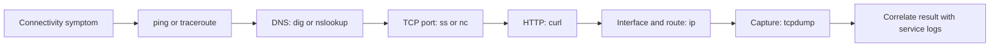

🗓️ 04102025 0025

# toolkit


Quick reference hub for networking command-line tools.

---

## Tool Categories

| Purpose | Tools | Detail Notes |
|---------|-------|--------------|
| **DNS lookup** | `dig`, `nslookup`, `host` | [[dns_tools]] |
| **Test connectivity** | `ping`, `traceroute` | [[connectivity]] |
| **HTTP/APIs** | `curl`, `wget` | [[http_tools]] |
| **Ports/connections** | `netstat`, `ss`, `lsof` | [[ports_connections]] |
| **Network config** | `ip`, `ifconfig` | [[interface_tools]] |
| **Advanced debugging** | `tcpdump`, `nmap` | [[advanced_debugging]] |
| **DNS overrides** | `/etc/hosts` | [[etc_hosts]] |

---

## Quick Command Reference

```bash
# Connectivity
ping example.com              # Test if host is reachable
traceroute example.com        # See network path

# DNS
dig example.com               # DNS lookup
dig @8.8.8.8 example.com     # Query specific DNS server

# HTTP
curl https://example.com      # Test HTTP
curl -I https://example.com   # Headers only

# Ports
netstat -tuln                 # Listening ports
lsof -i :8080                # What's using port 8080?

# Network Info
ip addr show                  # Show IPs (Linux)
ifconfig                      # Show IPs (Mac)
```

---

## Troubleshooting Flow

```
Website not loading?
  ↓
1. ping google.com         → Network working?
  ↓
2. dig example.com         → DNS resolving?
  ↓
3. ping example.com        → Host reachable?
  ↓
4. curl -I example.com     → Web server responding?
```

---



## References


- dns tools - DNS tools (dig, nslookup, host, whois)
- connectivity - Connectivity tools (ping, traceroute)
- http tools - HTTP tools (curl, wget)
- ports connections - Port tools (netstat, ss, lsof)
- interface tools - Interface tools (ip, ifconfig)
- advanced debugging - Advanced tools (tcpdump, nmap)
- etc hosts - Local DNS overrides
