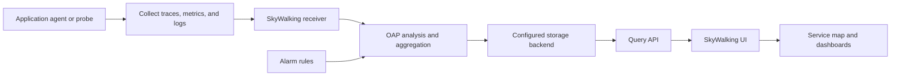

🗓️ 05082024 1036

# skywalking

> **Apache SkyWalking**: An open-source application performance monitoring platform for distributed systems. ([Apache SkyWalking](https://skywalking.apache.org/docs/main/latest/en/))

An open-source application performance monitoring (APM) system designed for
- distributed systems (esp. microservices)
- cloud-native architectures
- containerised environments (e.g. [[kubernetes]])

```ad-abstract
A health check and diagnostic tool for your applications

Provides insights into:
- how different parts of your application are performing
- how they interact
- helps pinpoint issues that might be causing slowdowns or errors

```

## How is Skywalking Used?
Skywalking works by collecting data from various points in your application and infrastructure.

- **Distributed Tracing**
	- Tracks the flow of requests as they move through different services
- **Metrics Collection:** 
	- Response times, error rates, and resource usage
- **Log Integration:** Correlates logs with traces and metrics

## Operational impact
- **Observability:** It provides the essential "three pillars" of observability: metrics, logs, and traces.
- **Lightweight:** Skywalking is designed to be lightweight and have minimal impact on your application's performance.  
- **Language Agnostic** 
- **Cloud-Native Ready** Skywalking integrates well with cloud-native technologies like Kubernetes, service meshes, and cloud providers.


---



## References


- [Apache SkyWalking documentation](https://skywalking.apache.org/docs/main/latest/en/)
