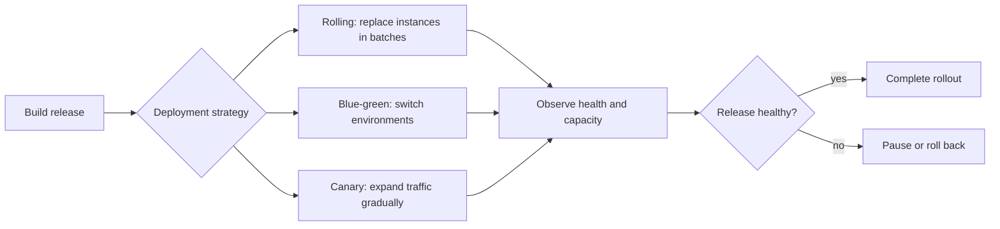

🗓️ 08042026 1500

# deployment_strategies


Deployment strategies control how a new application version replaces or shares traffic with the current version.

## Terms

| Term | Definition | Source |
|---|---|---|
| **Rolling deployment** | A rollout that replaces application instances in batches. | [Kubernetes](https://kubernetes.io/docs/tutorials/kubernetes-basics/update/update-intro/) |
| **Blue-green deployment** | A rollout that switches traffic between two separately deployed environments. | [AWS Prescriptive Guidance](https://docs.aws.amazon.com/prescriptive-guidance/latest/choosing-deployment-strategy/blue-green.html) |
| **Canary deployment** | A rollout that sends a limited amount of traffic to a new version before expanding it. | [Google Cloud](https://cloud.google.com/deploy/docs/deployment-strategies/canary) |

## Overview
- The different approaches to releasing a new version of your application to production
- Each strategy trades off between speed, safety, cost, and complexity

## Operational impact
- The wrong strategy for your situation means either unnecessary downtime, wasted infrastructure cost, or undetected bugs reaching all users
- Understanding the trade-offs lets you pick the right one for your scale and risk tolerance

## Strategy Comparison

| Strategy | Downtime | Rollback speed | Infra cost | Mixed versions | Blast radius |
|----------|----------|---------------|------------|----------------|--------------|
| **Recreate** | Yes | Slow (redeploy) | 1x | No | 100% |
| **[[rolling_deployment]]** | No | Medium (reverse roll) | 1x | Yes | Gradual |
| **[[blue_green_deployment]]** | No | Instant (switch back) | 2x during deploy | No | 100% on switch |
| **[[canary_deployment]]** | No | Fast (reroute) | ~1x + canary | Yes (controlled) | Small → gradual |
| **Shadow/dark** | No | N/A (no user impact) | 2x | N/A | 0% |

## Recreate (Big-Bang)

- Stop all old instances, deploy new, start them
- Simplest strategy — no mixed versions, no routing complexity
- **Has downtime** — only acceptable when maintenance windows exist or the app can't run two versions simultaneously
- Use for: internal tools, batch processing jobs, apps with incompatible version transitions

## Shadow / Dark Launch

- New version receives a copy of real traffic but responses are discarded
- Users only see responses from the old version
- Purpose: test new version's performance and correctness under real load without user impact
- Use for: major rewrites, new infrastructure, performance-critical systems
- Requires infrastructure to duplicate and route traffic

## Decision Guide

### Start with: what can you afford?

### Single server, small team
- rolling deployment or recreate
- Minimal infrastructure overhead
- Rolling gives you zero-downtime; recreate if you can tolerate a maintenance window

### Need instant rollback
- blue green deployment
- Worth the 2x cost during deployment if rollback speed is critical (payments, financial services)

### High traffic, need safety
- canary deployment
- Requires monitoring and traffic-splitting infrastructure
- Best blast-radius control

### Major rewrite, high risk
- Shadow/dark launch first, then canary
- Validate under real load before any user sees the new version

### For your multi-client Docker setup
- Start with rolling deployment via [[docker_swarm]] or simple compose restart strategy
- If clients have strict uptime SLAs: blue green deployment with two compose stacks behind a [[reverse_proxy]]
- Canary is overkill until you have enough traffic and monitoring to make the observation meaningful

```ad-warning
**All zero-downtime strategies require backward-compatible database migrations**: If your new version needs schema changes that break the old version, no deployment strategy can save you. Always decouple schema migrations from code deployments — migrate first, deploy second.
```

---



## References


- https://thenewstack.io/deployment-strategies/
- https://www.redhat.com/en/topics/devops/what-is-blue-green-deployment
