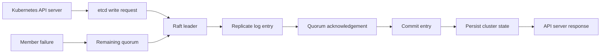

🗓️ 27082025 2343

# etcd

> **etcd**: A distributed key-value store designed for reliable storage of critical data. ([etcd documentation](https://etcd.io/docs/))

Kubernetes uses etcd to persist cluster state. The API server mediates access; etcd replicates committed changes across its members using Raft.

## Replication path

The API server sends a write to etcd. The leader replicates the log entry to members, commits it after a quorum acknowledges, then returns the result.

## Read consistency

- Linearizable reads reflect the latest committed state and require coordination with the leader.
- Serializable reads may return stale data and can be served without that coordination.
- Choose the read mode based on whether freshness or lower coordination cost matters.

## What etcd stores

Kubernetes stores API objects such as Pods, Services, Secrets, ConfigMaps, role bindings, and custom resources. Other systems can use etcd for configuration, metadata, and service discovery.

## Boundaries

- A cluster needs a majority of members to commit changes.
- Losing quorum prevents writes and can limit linearizable reads.
- Keep etcd access restricted; Kubernetes clients should use the API server.

## References

- [etcd architecture](https://etcd.io/docs/v3.5/learning/)
- [etcd FAQ](https://etcd.io/docs/v3.5/faq/)
- [Kubernetes etcd cluster](https://kubernetes.io/docs/tasks/administer-cluster/configure-upgrade-etcd/)
- [Raft paper](https://raft.github.io/raft.pdf)
