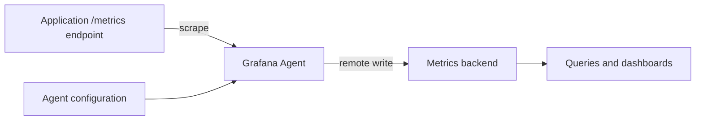

🗓️ 11112025 1630

# grafana_agent

> **Grafana Agent**: A telemetry collector that gathers and forwards metrics, logs, and traces to configured backends. ([Grafana Agent](https://grafana.com/docs/agent/latest/about/))

Grafana Agent collected telemetry near its source and sent it to a remote system. This was useful when a central Prometheus server could not reach targets behind a firewall.

## Collection path

In metrics pipelines, the agent discovered or received targets, scraped their Prometheus endpoints, applied configured processing, and sent samples using Prometheus remote write. The target exposed metrics; the agent owned scraping and forwarding; the remote backend owned storage and queries.

The agent could also collect logs and traces through separate pipelines. It did not provide Prometheus's local time-series database or query engine, so a backend was required for durable storage and querying.

## Lifecycle

Grafana Agent reached end of life on November 1, 2025. It no longer receives vendor support, security fixes, or bug fixes. Grafana recommends migrating Agent deployments to [[grafana_alloy]].

## Limits

- Outbound forwarding still depends on network access to the backend.
- Remote write failure can queue samples locally until configured limits apply.
- Agent configuration and supported components depend on its mode and version.

## References

- [Grafana Agent overview and lifecycle](https://grafana.com/docs/agent/latest/about/)
- [Grafana Agent metrics configuration](https://grafana.com/docs/agent/latest/static/configuration/metrics-config/)
- [Prometheus remote write](https://prometheus.io/docs/prometheus/latest/configuration/configuration/#remote_write)
