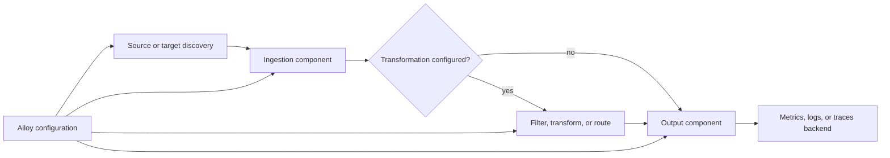

🗓️ 11112025 1730

# grafana_alloy

> **Grafana Alloy**: An open source telemetry collector that gathers and forwards data through configurable components. ([Grafana Alloy](https://grafana.com/docs/alloy/latest/introduction/))

Alloy lets an operator define how telemetry travels from its source to one or more backends. It is Grafana Agent's recommended successor and supports Prometheus-style and OpenTelemetry collection paths.

## Collection path

In Alloy's default engine, components discover targets, ingest telemetry, optionally transform it, and send it onward. Configuration connects the components; data follows those connections. A missing connection means the data stops at that point.

For example, a Prometheus scrape component can collect an application's `/metrics` endpoint, then forward samples to a remote-write component. An OpenTelemetry receiver can instead accept pushed OTLP data and pass it through connected processors and exporters.

## Engines and boundaries

The default engine uses Alloy configuration syntax and is the standard Alloy runtime. Alloy also embeds an OpenTelemetry Collector runtime, called the OTel Engine, which uses Collector YAML configuration. Grafana documents the OTel Engine as experimental; the two engines have different runtimes and configuration models.

Alloy collects and processes telemetry. A backend still provides durable storage, querying, dashboards, or alerting. One Alloy deployment can forward different signals to different destinations when its configuration defines those paths.

## Migration from Grafana Agent

Grafana Agent reached end of life on November 1, 2025. Grafana recommends migrating its Static, Flow, and Operator modes to Alloy. Agent configuration may need conversion and review because component names and configuration models differ.

## References

- [Grafana Alloy overview](https://grafana.com/docs/alloy/latest/introduction/)
- [How telemetry flows through Alloy](https://grafana.com/docs/alloy/latest/introduction/telemetry/)
- [OpenTelemetry Engine](https://grafana.com/docs/alloy/latest/introduction/otel_alloy/)
- [Grafana Agent lifecycle](https://grafana.com/docs/agent/latest/about/)
