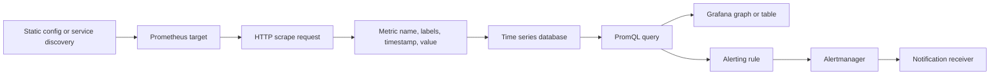

🗓️ 31102024 1149

# overview

Prometheus discovers metric endpoints, scrapes them, stores time series, and evaluates queries and alert rules. This note explains the monitoring path; [[metrics_learning_path]] teaches how to read dashboard measurements.

## Terms

| Term | Definition | Source |
|---|---|---|
| **Metric** | A named measurement exposed by an application or exporter. | [Prometheus data model](https://prometheus.io/docs/concepts/data_model/) |
| **Time series** | A stream of timestamped values identified by a metric name and label set. | [Prometheus data model](https://prometheus.io/docs/concepts/data_model/) |
| **Sample** | A timestamp and value stored for a time series. | [Prometheus data model](https://prometheus.io/docs/concepts/data_model/) |
| **Label** | A key-value dimension attached to a time series. | [Prometheus data model](https://prometheus.io/docs/concepts/data_model/) |
| **Target** | An endpoint that Prometheus is configured to scrape. | [Prometheus configuration](https://prometheus.io/docs/prometheus/latest/configuration/configuration/) |
| **Scrape** | An HTTP request Prometheus makes to read a target's metrics. | [Prometheus getting started](https://prometheus.io/docs/prometheus/latest/getting_started/) |
| **PromQL** | Prometheus's query language for selecting and transforming time series. | [Prometheus query basics](https://prometheus.io/docs/prometheus/latest/querying/basics/) |

## Collection and query path

Service discovery or static configuration supplies targets. Prometheus requests each target's metrics endpoint and stores the returned samples. PromQL reads and transforms stored series; dashboards display query results, while alerting rules evaluate conditions and send alerts to Alertmanager.



## Data model

A metric name describes what is measured. Labels distinguish dimensions such as method or status. Each unique name and label set identifies a separate time series.

```prom
# HELP http_requests_total Total processed HTTP requests.
# TYPE http_requests_total counter
http_requests_total{status="200"} 8556
http_requests_total{status="404"} 20
http_requests_total{status="500"} 68
```

The three label values above create three time series under one metric name. A label with unbounded values, such as user ID, can create excessive series.

## Exposition format

Targets usually expose metrics as text at an HTTP endpoint. Prometheus parses metric names, labels, values, and optional metadata during each scrape.

```prom
# HELP process_open_fds Number of open file descriptors.
# TYPE process_open_fds gauge
process_open_fds 32
```

## Boundaries

- Prometheus uses a pull model by default; targets do not push every sample.
- A scrape failure leaves the target without a fresh sample for that interval.
- PromQL query results depend on time range, evaluation time, and labels.
- Alert rules evaluate expressions; Alertmanager handles grouping and notification routing.

## References

- [Prometheus overview](https://prometheus.io/docs/introduction/overview/)
- [Prometheus data model](https://prometheus.io/docs/concepts/data_model/)
- [Prometheus exposition formats](https://prometheus.io/docs/instrumenting/exposition_formats/)
- [Prometheus alerting rules](https://prometheus.io/docs/prometheus/latest/configuration/alerting_rules/)
- [Alertmanager](https://prometheus.io/docs/alerting/latest/alertmanager/)
