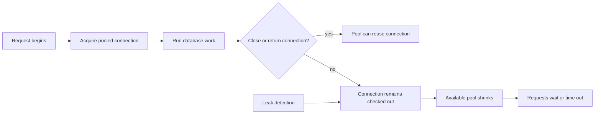

🗓️ 25042026 1436

# connection_leak

> **Connection leak**: A connection acquired from a pool that is not returned or closed after use. ([HikariCP](https://github.com/brettwooldridge/HikariCP))

> Connections opened but never returned to the pool / closed. Pool exhausts, new requests block or fail. A **quantity** problem.

## Mechanism

A connection pool has a max size (e.g. 50 DB connections). Caller borrows a connection, uses it, **must return it**. Forget to return → pool's "in-use" count climbs over time. Once `in_use == max`, every new acquire blocks until timeout.

Common causes:

```java
// BAD — connection never closed if SQL throws
Connection conn = pool.getConnection();
PreparedStatement ps = conn.prepareStatement(sql);
ps.execute();
conn.close();  // never reached on exception

// GOOD — try-with-resources guarantees close
try (Connection conn = pool.getConnection();
     PreparedStatement ps = conn.prepareStatement(sql)) {
  ps.execute();
}
```

Other vectors:
- Async flow forgets to release on error path
- Connection stored in a long-lived field, never returned
- Borrow-then-spawn-thread; thread crashes; connection orphaned
- Library bug — driver doesn't return on certain error codes

## Symptoms

- Slow ramp over hours / days — error rate climbs as pool saturates.
- Errors like `Cannot acquire connection`, `Pool exhausted`, `Timeout waiting for connection`.
- Restart = full reset → "fixes" it temporarily → reappears days later.
- Eventually OOM if connections also pin native memory.
- Affects **all callers** of the pool, not a subset.

## Detection

- Pool metrics — graph `in_use` connections over time. Steady ramp = leak.
- Stack traces of long-held connections (most pools support this in debug mode).
- `ss -tn state established` count climbing.
- App memory growing without obvious heap correlation (native side).

## Fix

- Find the leak: enable pool's leak detection (`leakDetectionThresholdMs` in HikariCP).
- Wrap every borrow in try-with-resources / `using` / RAII.
- Audit async paths for missing release on error.

## What Leaks Are NOT

- **Not** a "stale connection" — leaked connections are healthy, just not returned.
- **Not** the same as a connection wedge ([[connection_wedge]]) — wedge is a quality problem on a single connection that's still "in the pool"; leak is a quantity problem with the pool itself.

## Key Takeaways

- **Leak = forgot to release.** Always pair acquire with a guaranteed release primitive.
- **Time profile matters**: leak is a **ramp** (hours/days). State-flip failures (wedge, network event) are **cliffs** (seconds).
- Leak detection is cheap to enable — turn it on in any pool from day one.

---



## References


- [HikariCP leak detection](https://github.com/brettwooldridge/HikariCP#frequently-used)
- connection wedge — different failure mode, same surface
- [[error_timeline_shapes]] — ramp vs cliff diagnostic
