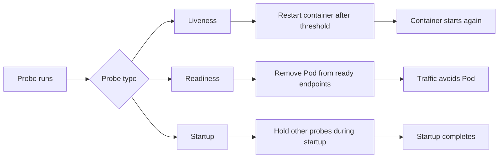

🗓️ 03092024 1153

# health_checks

A health check reports one condition about an application. Orchestrators and monitoring systems use the result to choose an action.

## Terms

| Term | Definition | Source |
|---|---|---|
| **Liveness probe** | A check that determines whether a container should be restarted. | [Kubernetes](https://kubernetes.io/docs/concepts/configuration/liveness-readiness-startup-probes/#liveness-probe) |
| **Readiness probe** | A check that determines whether a container should receive traffic. | [Kubernetes](https://kubernetes.io/docs/concepts/configuration/liveness-readiness-startup-probes/#readiness-probe) |
| **Startup probe** | A check that delays liveness and readiness checks until startup succeeds. | [Kubernetes](https://kubernetes.io/docs/concepts/configuration/liveness-readiness-startup-probes/#startup-probe) |

## Probe result and action

A probe runs against a container and reports success or failure. The probe type determines what Kubernetes changes after failure.

## Choosing the probe

- Use liveness for deadlocks or unrecoverable process states.
- Use readiness for temporary inability to serve requests.
- Use startup for applications with slow initialization.
- Keep liveness independent from transient dependency failures.

## Common misreading

A failed readiness probe removes a Pod from ready service endpoints. It does not restart the container. A failed liveness probe can trigger a restart after the configured threshold.

## References

- [Kubernetes probes](https://kubernetes.io/docs/concepts/configuration/liveness-readiness-startup-probes/)
