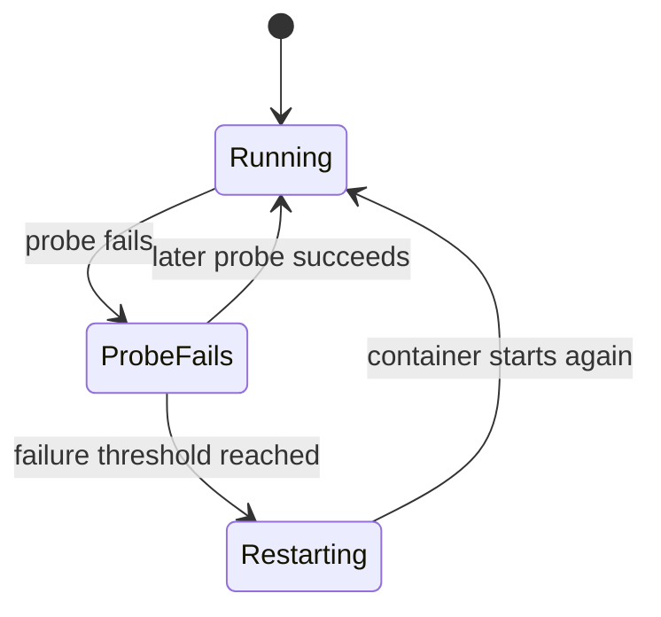

🗓️ 14042025 1636

# liveness_checks

> **Liveness probe**: A check Kubernetes uses to determine whether to restart a container. ([Kubernetes](https://kubernetes.io/docs/concepts/configuration/liveness-readiness-startup-probes/#liveness-probe))

A liveness probe detects a container that is running but cannot recover on its own. For probe types, see [[health_checks]].

## Failure path

Kubelet runs the configured probe. After the failure threshold, it restarts the container according to the Pod's restart policy.

## Probe design

- Check process health that can recover through restart.
- Avoid making liveness depend on remote services.
- A slow dependency can otherwise restart healthy containers repeatedly.
- Set initial delay, timeout, and failure threshold for startup behavior.

## Boundary

A liveness failure can restart the container. It does not determine whether the Pod should receive traffic; readiness does that.

## References

- [Kubernetes liveness probes](https://kubernetes.io/docs/concepts/configuration/liveness-readiness-startup-probes/#liveness-probe)
