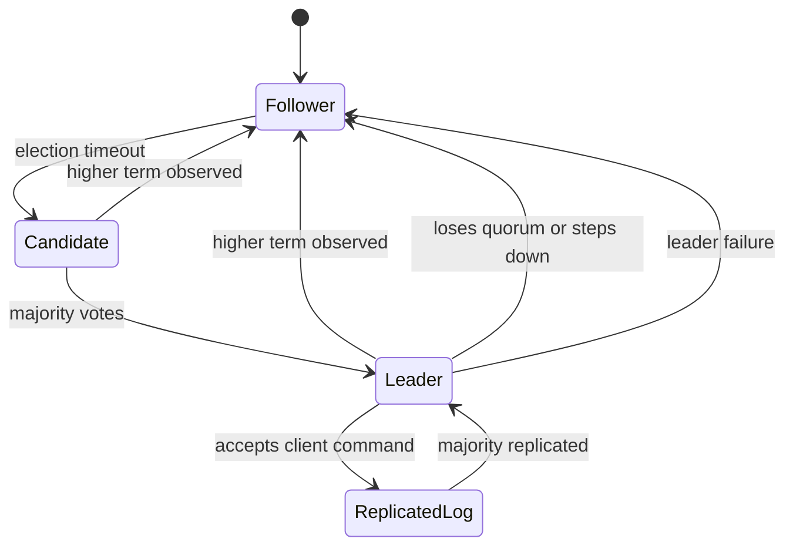

🗓️ 27082025 2344

# raft

> **Raft**: A consensus algorithm that helps a cluster agree on a replicated log while tolerating node failures. ([Raft paper](https://raft.github.io/raft.pdf))

Raft separates leader election, log replication, and safety to make consensus understandable.
## **Raft?** 

```ad-abstract
⛵ **Raft** is a **distributed consensus algorithm** designed to ensure that multiple nodes **agree on the same state**, even in the presence of failures.
```

- etcd uses Raft internally to **synchronize data across replicas**.

## Key Goals
- **Consistency**: All healthy nodes agree on the same log of updates.
- **Fault tolerance**: System works even if some nodes fail.
- **Leader-based design**: One leader handles all writes; followers replicate the log.

## How Raft Works (Simplified)
### Three core mechanisms
### Leader Election
- When a cluster starts or the leader dies:
    1. Nodes vote for a leader.
    2. A node becomes leader if it gets **majority votes**.
    3. Leader handles **all writes**.
### Log Replication
- Leader receives a write request, appends it to its **log**.
- Sends **AppendEntries RPCs** to followers.
- Once **majority of followers acknowledge**, the leader **commits** the entry.
### Safety & Consistency
- Raft guarantees that **committed entries are never lost**.
- Even if the leader crashes, the new leader has the latest committed log.

---



## References


- [Raft paper](https://raft.github.io/raft.pdf)
