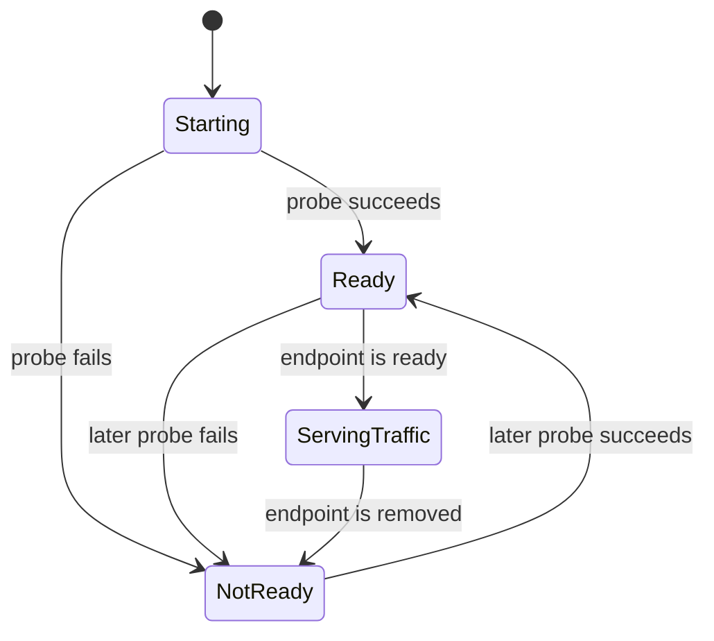

🗓️ 14042025 1637

# readiness_checks

> **Readiness probe**: A check Kubernetes uses to determine whether a container should receive traffic. ([Kubernetes](https://kubernetes.io/docs/concepts/configuration/liveness-readiness-startup-probes/#readiness-probe))

A readiness probe keeps a Pod out of ready service endpoints until it can serve requests. For probe types, see [[health_checks]].

## Endpoint path

Kubelet runs the probe and reports the result to the API server. Endpoint controllers then include or remove the Pod from ready service endpoints.

## Probe design

- Check whether the application can serve its expected requests.
- Use readiness for startup and temporary overload.
- Include dependencies only when their failure blocks useful service.
- A failed readiness probe does not restart the container.

## Boundary

Readiness controls traffic eligibility. Liveness controls restart decisions. Keep these checks separate when they represent different failure conditions.

## References

- [Kubernetes readiness probes](https://kubernetes.io/docs/concepts/configuration/liveness-readiness-startup-probes/#readiness-probe)
