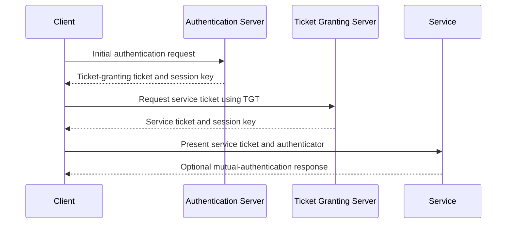

🗓️ 14012025 1109

# kerberos

Kerberos lets a client authenticate to a trusted authority once, then request tickets for individual services. The client presents a service ticket instead of sending its password to every service.

## Terms

| Term | Definition | Source |
|---|---|---|
| **Key Distribution Center (KDC)** | A network service that issues tickets and temporary session keys for a Kerberos realm. | [RFC 4120](https://www.rfc-editor.org/rfc/rfc4120) |
| **Ticket-granting ticket (TGT)** | A ticket that lets a client request service tickets after initial authentication. | [RFC 4120](https://www.rfc-editor.org/rfc/rfc4120) |
| **Service ticket** | A ticket that a client presents to a particular service during authentication. | [RFC 4120](https://www.rfc-editor.org/rfc/rfc4120) |
| **Authenticator** | Fresh client data encrypted with a session key to help a service verify a ticket request. | [RFC 4120](https://www.rfc-editor.org/rfc/rfc4120) |

## Ticket path

The KDC contains an Authentication Server (AS) and a Ticket-Granting Server (TGS). The AS issues a TGT after initial authentication. The TGS uses that TGT to issue a service-specific ticket. The client presents the service ticket and a fresh authenticator to the service.

## Security properties

- The client does not send its password directly to each service.
- Ticket lifetimes and timestamps limit replay opportunities.
- A service can authenticate the client and optionally prove its identity back.
- Kerberos authenticates identities. The service makes authorization decisions.
- Kerberos does not automatically encrypt all application traffic. Applications can use the session key for message integrity or confidentiality.

## Operational limits

- Clients and services need sufficiently synchronized clocks.
- The KDC is needed to obtain tickets; service access also depends on ticket validity and service configuration.
- A valid ticket does not grant permissions the service has not assigned.

## References

- [RFC 4120: Kerberos V5](https://www.rfc-editor.org/rfc/rfc4120)
