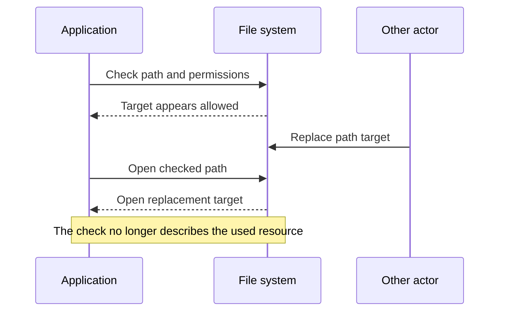

🗓️ 18102026 1625

# time_of_check_to_time_of_use

> **Time-of-check to time-of-use (TOCTOU)**: A race where a resource changes after software checks it but before software uses it. ([MITRE CWE-367](https://cwe.mitre.org/data/definitions/367))

TOCTOU is a security-relevant form of [[check_then_act]]. It matters when the changed resource can invalidate a permission, identity, or safety check.

## How the vulnerability appears

A program checks a path's permissions, then opens the path later. If another actor replaces the target between those operations, the program may open a different resource from the one it checked.

The risky assumption is that the checked property remains unchanged until use. MITRE describes this weakness for resources whose state changes between the check and use, including files, memory, and shared variables. ([CWE-367](https://cwe.mitre.org/data/definitions/367))

## Reducing the race

- Prefer one operation that checks and acquires the resource atomically.
- When supported, use an already-open handle for later operations.
- Avoid checking a pathname and later reopening it as trusted.
- Keep authorization tied to the resource actually being used.

Exact protections depend on the operating system and API. See [[check_then_act]] for the broader concurrency pattern.

## References

- [MITRE CWE-367: Time-of-check Time-of-use Race Condition](https://cwe.mitre.org/data/definitions/367)
