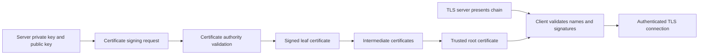

🗓️ 03042026 1523

# tls_certificates

> **TLS certificate**: A signed binding between an identity and a public key, used by TLS peers during authentication. ([RFC 5280](https://www.rfc-editor.org/rfc/rfc5280))

Certificates let clients verify server identity during TLS handshakes.

## Overview
- Digital documents that prove a server's identity and enable encrypted connections
- Issued by [[certificate_authorities]] — trusted third parties that verify ownership
- Presented during the [[tls]] handshake so the client can verify it's talking to the real server

## Problem addressed
- Without certificates: no way to verify you're talking to the real server (man-in-the-middle attacks)
- Without encryption: data transmitted in plaintext — passwords, tokens, client data exposed

## What a Certificate Contains

- **Subject**: the domain(s) the cert is valid for (`example.com`, `*.example.com`)
- **Issuer**: which CA signed it
- **Public key**: used during the TLS handshake for key exchange
- **Validity period**: not-before and not-after dates
- **Signature**: CA's cryptographic signature proving the cert is legitimate
- **Extensions**: extra metadata like Subject Alternative Names (SANs), OCSP URLs, Must-Staple flag

## Certificate Types

### Domain Validation (DV)
- Proves you control the domain (automated DNS/HTTP challenge)
- Cheapest, fastest — Let's Encrypt issues these for free
- Sufficient for most services

### Organization Validation (OV)
- Verifies organization identity in addition to domain
- Used by businesses wanting visible org name in cert details

### Extended Validation (EV)
- Strictest verification, legal entity checks
- No longer shows green bar in modern browsers — diminished visual benefit
- Skip unless compliance requires it

## Certificate Chain

- **Root CA** → **Intermediate CA** → **Server certificate**
- Browsers trust root CAs; intermediates are signed by roots; your cert is signed by an intermediate
- If any link in the chain is invalid, expired, or revoked — connection fails
- See certificate authorities for how the chain of trust works

## Multi-Client Certificate Strategy

For one server hosting multiple client domains:
- **Separate domains**: `client-a.example.com`, `client-b.example.com` — separate cert per domain or one wildcard
- **Wildcard cert** (`*.example.com`): covers all subdomains, simpler management, but if compromised all clients affected
- **SAN cert**: single cert listing multiple domains — less flexible than wildcard but more specific
- **Per-client certs**: maximum isolation, more operational overhead

For automating certificates in Docker, see [[docker_tls_termination]].

```ad-danger
**Expired certificates break everything**: Browsers block access, API clients reject connections, mobile apps crash. Automate renewal with ACME (see certificate authorities) — never rely on manual renewal for production.
```

```ad-warning
**Wildcard certs share a single private key for all subdomains**: If the key leaks, every client subdomain is compromised. For high-security multi-tenant setups, consider per-client certificates instead.
```

---



## References


- https://developer.mozilla.org/en-US/docs/Web/Security/Transport_Layer_Security
- https://www.ssl.com/faqs/what-is-a-certificate-authority/
