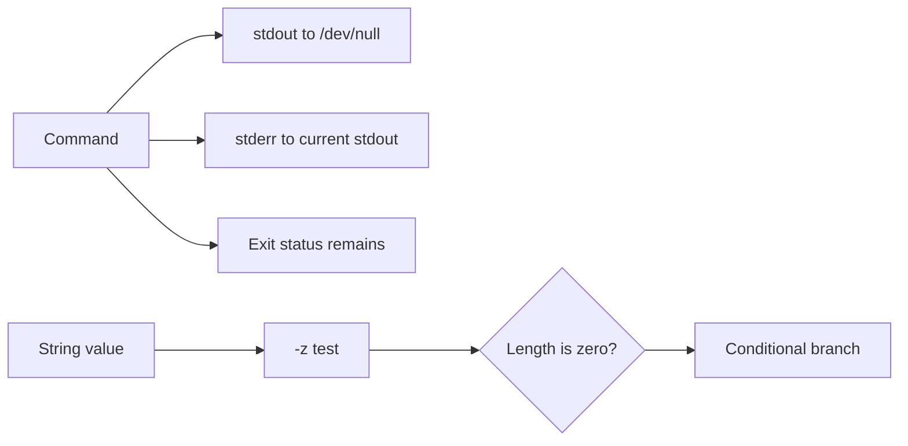

🗓️ 20102024 0117

# bash_dump

These shell patterns discard command output, inspect exit status, and test for an empty string.

## Terms

| Term | Definition | Source |
|---|---|---|
| **Redirection** | A shell operation that changes where a command reads input or writes output. | [GNU Bash manual](https://www.gnu.org/software/bash/manual/html_node/Redirections.html) |
| **File descriptor** | An integer that identifies an open input or output stream for a process. | [GNU Bash manual](https://www.gnu.org/software/bash/manual/html_node/Redirections.html) |
| **`-z` test** | A conditional test that succeeds when a string has zero length. | [GNU Bash manual](https://www.gnu.org/software/bash/manual/html_node/Bash-Conditional-Expressions.html) |

## Discard output and keep the exit status

```bash
tmux ls >/dev/null 2>&1
```

- `>/dev/null` sends standard output to the null device.
- `2>&1` sends standard error to the current standard output.
- Bash applies these redirections from left to right.
- The command's exit status remains available to the caller.

```bash
if tmux ls >/dev/null 2>&1; then
  echo "tmux has a session"
else
  echo "tmux has no session or failed"
fi
```

The non-zero status alone does not prove no session exists. It can also indicate another command failure.

## Test for an empty string

```bash
if [[ -z "$value" ]]; then
  echo "value is empty"
fi
```

`-z` is true when the expanded string has zero length. Quote expansions to avoid word splitting and glob expansion.



## References

- [GNU Bash redirections](https://www.gnu.org/software/bash/manual/html_node/Redirections.html)
- [GNU Bash conditional expressions](https://www.gnu.org/software/bash/manual/html_node/Bash-Conditional-Expressions.html)
- [tmux manual](https://man7.org/linux/man-pages/man1/tmux.1.html)
