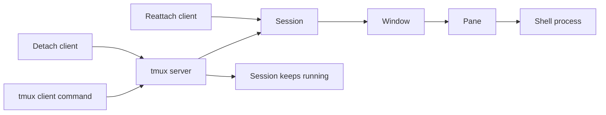

🗓️ 19102024 1034

# tmux

> **tmux**: A terminal multiplexer that lets users manage multiple terminal sessions and panes. ([tmux manual](https://man7.org/linux/man-pages/man1/tmux.1.html))

tmux keeps sessions available after a terminal disconnects and supports multiple panes.

## SHORTCUTS

> PREFIX: `ctrl + b` - start of all commands

### Plugins (TPM)
- `I` - update plugins
- `U` - update plugins

### Other commands
- `:` - Trigger commandline

### Split commands
- `"` - Splits screen horizontally
- `%` - Splits screen vertically
- `x` - Kills split
- 'ARROW_KEYS' - Moving across panes

### Window commands (Group of splits)
- `${NUMBER}` - Jumps to specified window
- `p / n` - Previous / next window
- `c` - **Create New Window** 
- `,` - **Rename Current Window** 
- **List Windows:** `Ctrl+b` then `w`.
- `&`: **Kill Current Window** 

### Session commands (Group of windows)
- `s` - List of sessions
- `(/)` - Previous / next session

## CMDLINE
- `tmux ls` - view list of sessions
- `tmux attach -t ${session}` - attach to a specific session
- `tmux detach` - detaches session from terminal

## Setup

- https://github.com/tmux-plugins/tpm

---

## References
- [tmux manual](https://man7.org/linux/man-pages/man1/tmux.1.html)
